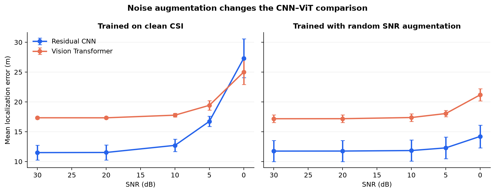
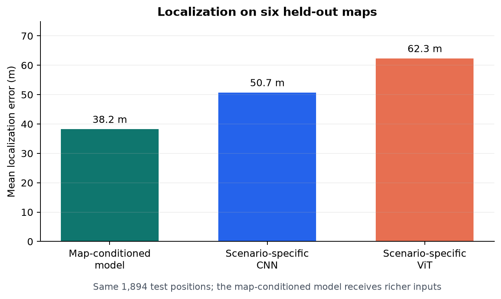

# User Localization from 5G Channel State Information (CSI)

This project investigates how 5G Channel State Information (CSI) can be used to
estimate a mobile user's position, and how a localization model can move beyond
the environment in which it was trained. I first compared similarly sized CNN and
Vision Transformer models that learn the CSI-to-position relationship for one
fixed environment. The CNN was more accurate on clean measurements, while the ViT
degraded less under severe white noise. Training with randomly selected noise
levels proved more effective than changing architecture: it reduced the CNN's
mean error at 0 dB SNR by **48%**, from **27.32 m to 14.21 m**, while preserving
its clean-CSI accuracy. I then designed a single map-conditioned Transformer for
localization across environments. It combines CSI from a variable number of base
stations with their coordinates and a building occupancy/height map, using a
masked Transformer to summarize the radio observations and cross-attention to
connect them to the map. The model was evaluated without retraining on six maps
excluded from training. On a shared set of test positions, it achieved **24.6%
lower mean error than CNNs trained specifically for each target environment**.

## Problem

Channel State Information (CSI) records the complex response of a radio channel
across antennas and OFDM subcarriers. Multipath reflections and delays make this
response dependent on a user's position, so CSI can act as a radio fingerprint.
The task is to regress a user's `(x, y)` coordinates from that fingerprint.

A CSI-only model is also tied to the environment where it was trained. Changing
the building layout or base-station positions changes the relationship between
CSI and coordinates. The project therefore moves from localization within one
known map to localization across maps that were excluded from training.

## Data and evaluation

DeepMIMO supplies precomputed ray-tracing paths. The experiments use a 3.5 GHz
carrier, 20 MHz bandwidth, 32 antennas, 64 selected OFDM subcarriers and up to 25
stored paths per link. Complex `32 × 64` CSI is represented by real and imaginary
channels. Normalization statistics are fitted on training data only.

The New York experiment contains 17,337 user positions. Whole `2 × 1 m` spatial
tiles are assigned to train, validation or test, reducing leakage between nearby
samples. The multi-map dataset contains 83,968 examples from 41 maps; entire maps
are split into 29 training, six validation and six test environments.

Models minimize MSE on normalized coordinates. Selection uses validation mean
distance, while final evaluation reports Euclidean error in metres: mean, median,
P90, P95 and empirical CDFs.

## Experiments

### CNN versus Vision Transformer

The residual CNN has 451,762 parameters. The 460,322-parameter ViT divides CSI
into 64 patches and uses four Transformer layers. Both models use the same split,
optimizer, 35-epoch budget and three random seeds.

On clean New York CSI, the CNN achieved **11.50 ± 1.24 m** mean error, compared
with **17.32 ± 0.19 m** for the ViT. The ViT's global attention did not improve
accuracy under this data budget.

With clean-only training, the ViT degraded less under severe AWGN and overtook the
CNN at 0 dB SNR. I then retrained both models with online noise augmentation: SNR
sampled uniformly from 0 to 30 dB, with 20% of examples left clean. The augmented
CNN reached **14.21 m** at 0 dB while retaining **11.75 m** on clean CSI. It then
outperformed the augmented ViT at every tested SNR.



### Generalization to unseen maps

The general model receives a variable set of CSI measurements, base-station
coordinates and a building occupancy/height raster:

1. A shared CNN encodes each station's CSI.
2. An MLP encodes each station's coordinates.
3. A masked Transformer aggregates the station tokens without depending on their
   order.
4. A map CNN produces spatial tokens from building geometry and x/y coordinate
   channels.
5. Cross-attention lets the radio summary query the map before coordinate
   regression.

The reference model reached **35.46 m mean** and **21.46 m median** error on all
12,288 users from the six held-out maps, without training on labelled positions
from those environments.

For a direct comparison, separate CSI-only CNNs and ViTs were trained on 70% of
each target map and evaluated on the same 1,894 positions as the general model.

| Model | Target-map training | Mean error |
|---|---:|---:|
| Map-conditioned model | None | **38.24 m** |
| Scenario-specific CNN | 70% of positions | 50.73 m |
| Scenario-specific ViT | 70% of positions | 62.35 m |



This is a system-level comparison rather than an isolated map-encoder ablation.
The general model also receives multiple CSI links and station coordinates, has
more parameters, and was trained on more environments.

### CSI-position fusion ablation

I compared element-wise addition, a shared concatenation MLP and sigmoid-gated
fusion while keeping the rest of the model and training protocol fixed. Each
condition was trained with three seeds, for nine full runs.

Addition had the lowest validation error. The concatenation MLP was the better
learned alternative and was selected before test evaluation. It reduced test mean
error from **36.16 m to 33.87 m** and median error from **22.09 m to 18.27 m**, but
added 5.8% more parameters and slightly worsened P90/P95. Addition remains the
default because the learned variant did not improve every metric or validation
performance.

## Reproduction

The project uses Python 3.11, PyTorch, DeepMIMO, NumPy/SciPy and Matplotlib. Raw
DeepMIMO scenarios and processed datasets are not stored in the repository.

```powershell
python -m venv .venv
.\.venv\Scripts\python.exe -m pip install -r requirements.txt

# Train the New York CNN and ViT across the configured seeds.
.\.venv\Scripts\python.exe -m src.experiment --config configs/experiments/city_0_newyork_3p5_max_32x64.json --stage train

# Run one fusion condition; repeat for three modes and three seeds.
.\.venv\Scripts\python.exe tools/run_fusion_ablation.py --fusion add --seed 42

# Run the test suite.
.\.venv\Scripts\python.exe -m pytest -q
```

Dataset preparation is documented in [docs/MULTIMAP_DATA.md](docs/MULTIMAP_DATA.md).
The [technical report](report/technical-report.md) covers the radio model and
experimental limitations. Detailed fusion results are in
[docs/FUSION_ABLATION_RESULTS.md](docs/FUSION_ABLATION_RESULTS.md).

## Limitations

All results use simulated channels and one fixed radio configuration. AWGN does
not represent structured interference, mobility or hardware errors. The multi-map
model assumes that station positions and the target building map are available at
inference. Results from three seeds and one map split are descriptive rather than
a statistical significance claim. Evaluation on measured CSI remains necessary.
